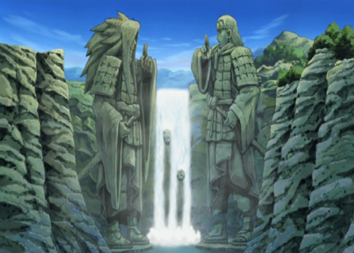

# Game-mod — NARUTO vs SASUKE: Pertarungan Lembah Akhir 🍥⚔️

Game pertarungan 2D **format HTML** (Canvas + JavaScript, tanpa library) — Naruto Mode Chakra Kurama melawan Sasuke Taka di Lembah Akhir (Valley of the End), memakai **sprite sheet gaya Jump Ultimate Stars (JUS)** yang dirujuk & diolah dari internet.



## ▶️ Cara Main / Menjalankan

- **Langsung:** buka `index.html` di browser (Chrome/Edge/Firefox).
- **Lewat server lokal** (disarankan): `python3 -m http.server 8000` lalu buka `http://localhost:8000`.
- Mode: **1 Pemain vs CPU** (pilih Naruto/Sasuke + tingkat kesulitan Mudah/Normal/Sulit) atau **2 Pemain** dalam 1 keyboard.
- Menang 2 ronde (ronde 99 detik) untuk jadi juara. Di layar sentuh tersedia tombol virtual.

## 🎮 Kontrol

| Aksi | Pemain 1 | Pemain 2 |
|---|---|---|
| Jalan | `A` / `D` | `←` / `→` |
| Lompat | `W` | `↑` |
| Blok (tahan) | `S` | `↓` |
| Dash | ketuk tombol jalan 2× | ketuk tombol jalan 2× |
| Pukul (kombo 3× tekan beruntun) | `J` | `Numpad 1` / `B` |
| Serangan Berat | `K` | `Numpad 2` / `N` |
| Lempar Shuriken | `L` | `Numpad 3` / `M` |
| Jutsu (30 chakra) | `U` | `Numpad 4` / `,` |
| Ultimate (100 chakra) | `I` | `Numpad 5` / `.` |
| Jeda | `Esc` | `Esc` |

**Jutsu menyesuaikan jarak:** dekat/sedang → **Rasengan** / **Chidori** (dash menubruk — bisa **BENTROK** kalau dipakai bersamaan!); jauh → **Rasen-Shuriken** / **Katon: Goukakyuu no Jutsu**.
**Ultimate:** Naruto — *Rasen-Shuriken Raksasa*; Sasuke — **Kirin** (hindari dengan lompat tinggi / dash keluar dari tanda sasaran).

## ✨ Fitur

- Animasi sprite lengkap per aksi: idle, lari, lompat/jatuh, dash (+bayangan), blok (Sasuke memakai tulang **Susanoo**!), terpukul, knockdown, intro Sasuke melepas jubah, pose menang/KO.
- Sistem pertarungan: kombo 3 pukulan, serangan berat & udara, launch, knockdown, blok + chip damage, hitstop, screenshake, penghitung kombo, angka damage.
- Proyektil (shuriken, bola api, rasen-shuriken) yang bisa saling bertabrakan; cut-in potret saat Ultimate.
- Arena di atas air: pantulan karakter, riak air, partikel aura Kurama & petir Chidori, efek ledakan/asap/Amaterasu dari sprite FX.
- CPU AI 3 tingkat kesulitan, skor ronde best-of-3, timer, jeda, tanding ulang.
- Suara & musik disintesis WebAudio (tanpa file eksternal).

## 📁 Struktur

```
index.html                  <- game utama (semua CSS/JS inline; manifest sprite tertanam)
assets/valley.jpg           <- background Lembah Akhir
assets/sprites/manifest.json
assets/sprites/naruto/*.png <- strip sprite Naruto per aksi (seragam, siap pakai)
assets/sprites/sasuke/*.png <- strip sprite Sasuke per aksi
assets/sprites/fx/*.png     <- rasengan, fireball, ledakan, naga kirin, asap, dll.
tools/build_sprites.py      <- script pemotong/pengemas sprite dari sumber internet
```

## 🙏 Kredit & Referensi Sprite (dari internet)

Fan game non-komersial untuk belajar. Naruto © Masashi Kishimoto / Shueisha / Studio Pierrot.

- Strip per-aksi + atlas JSON gaya JUS: repo GitHub [`Omololu457/multiverse-smash`](https://github.com/Omololu457/multiverse-smash) (`naruto_kcm_*.png`, `sasuke_*.png`, `tools/atlases/naruto.json` & `sasuke.json`).
- Referensi sheet orisinal: [Sprite Database — Sasuke (DS *Naruto Shippūden: Naruto vs. Sasuke*), rip oleh Neimad](https://spritedatabase.net/file/1397) dan [The Spriters Resource — *Jump Ultimate Stars*](https://www.spriters-resource.com/ds_dsi/jus/).
- Background Lembah Akhir & shuriken: repo GitHub [`mission-coding/Naruto-Vs-Sasuke`](https://github.com/mission-coding/Naruto-Vs-Sasuke).
- Sheet Naruto DS lengkap (referensi pose Rasengan/Kage Bunshin/Kyuubi): repo GitHub [`SKJTCodes/Naruto`](https://github.com/SKJTCodes/Naruto).

Sprite mentah dari sumber di atas dipotong ulang (rect atlas & kolom alpha), dibersihkan dari teks label sheet, lalu dikemas menjadi strip seragam oleh `tools/build_sprites.py`.
